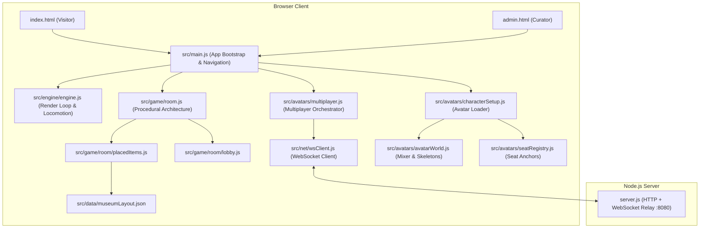

# System Architecture — Our Museum 3D

**Current Baseline:** 05 November 2026  
**Tech Stack:** Three.js (r182 via ESM), Vite 7, Node.js HTTP/WebSocket (`ws` 8), Vanilla JavaScript (No frameworks).

---

## 1. High-Level System Overview

**Our Museum 3D** is an ultra-luxury, photorealistic 3D virtual art museum and memorial sanctuary. The application operates across two dedicated entry surfaces:
1. **Public Visitor Experience (`index.html` → `/src/main.js`)**: Clean, distraction-free gallery experience featuring character selection, third-person avatar exploration, live 2-player multiplayer, 61 high-resolution artworks, photo enlargement lightbox, and ambient audio.
2. **Curator Studio (`admin.html` → `/src/main.js` with `admin-mode`)**: Inherits the full visitor runtime and adds the golden `✦ ADMIN STUDIO ✦` badge, `[R]` Live Resizer HUD, placement tools, and configuration export.

---

## 2. Core Subsystems & Execution Flow

### 2.1 Bootstrap, Entry Gate & Progress Bar
1. `src/main.js` mounts the UI canvas and modal overlay.
2. Character selection presents the roster from `src/data/characters.json` (Maya & Ethan).
3. **Entrance Readiness Gating (`engine.ready`)**:
   - The "ENTER SANCTUARY" button is locked until:
     * Current room geometry and lighting are fully built.
     * All tracked GLB model spawns (including corner botanical plants) complete.
     * Deferred artwork textures are loaded.
     * Selected avatar mesh, textures, and animation clips are fetched and retargeted.
     * WebGL shaders are pre-warmed via `renderer.compile(currentRoom.group, camera)`.
   - A 0–100% native progress bar displays real asset completion without synthetic timers or fake delays.

### 2.2 Locomotion, Third-Person Camera & Collision
- **Movement Anchor**: The engine camera/position vector remains the primary navigation and collision anchor in `src/engine/engine.js`.
- **Third-Person Follow Camera**:
  - Automatically follows the selected local avatar (`Maya` or `Ethan`).
  - Positioned behind and slightly above the character with smooth damping.
  - Handles visual picking and preserves line-of-sight against room walls.
- **Triangle-Based Collision Footprints**:
  - Imported 3D floor models generate static 2D walking footprints from transformed mesh triangles sampled on a 15 cm grid.
  - Geometry within 8 cm of the model base (flat ground decor/rugs) and above 1.7 m (upper ceiling trims) is excluded.
  - Occupied cells are merged into simplified bounding rectangles for fast, low-overhead obstacle collision solving.
  - Walkable gaps between separate parts of a single model (e.g. sofa cushions and table gaps) remain accessible.

### 2.3 Room Lifecycle & Spatial Geometry
- **Room Topology**:
  - **Grand Lobby (Central Rotunda)**: Width $X \in [-10.5, +10.5]$, Length $Z \in [-6.0, +6.0]$, Height $4.0\text{m}$. Elevated East/West promenade platforms at $Y = 1.4\text{m}$ with higher ceilings at $Y = 5.6\text{m}$.
  - **6 Themed Salons**: Width $X \in [-5.0, +5.0]$, Length $Z \in [-6.0, +6.0]$, Height $4.0\text{m}$, centered divider partition at $Z = 0$.
    1. `fireside` — Fireside Winter Memories
    2. `music` — Music & Classical Melodies
    3. `library` — The Library & Reading Nook
    4. `paris` — Masterpiece Paris Romance
    5. `orangery` — The Glass Orangery
    6. `alcove` — The Secret Promise Alcove
- **Door Locomotion & Continuity**:
  - Symmetrical platform portals lead to salons; salon exit returns the user to the exact platform door with outwards orientation.
  - Corner transition doors (`seealso` 0–5) allow seamless salon-to-salon hopping.
  - Door click raycasting reaches up to 6.0 meters; walking within 0.50 meters smoothly triggers room transition.
- **Resource Lifecycle & Caching**:
  - `disposables`: Every room maintains a disposal array; geometries, materials, and textures are evicted upon room transition.
  - `staticCache.js`: Retains shared procedural linen-plaster wallcovers and parquet bump maps.
  - `doorPlaqueTextureCache`: Pre-renders and caches door plaque canvases by title to prevent memory allocations during navigation.
  - Bounded room cache preserves up to 3 visited rooms in background memory.

### 2.4 3D GLB Model Placement Pipeline
- Placed models are cataloged in `src/data/museumLayout.json` with schema:
  `{ "id", "type": "glb", "path", "position": {x,y,z}, "rotationY", "scale", "contact" }`.
- Models are sourced from `public/models/ready/{furniture,lighting,plants}/` with metadata in `models.manifest.json` and attributions in `ATTRIBUTIONS.md`.
- Shared `GLTFLoader` cache loads each model path once, and spawns clone instances with independent transforms.
- Heights are normalized using recorded `realHeightMetres` so real-world dimensions match reality.
- Floor items register static collision footprints; ceiling/wall items bypass floor collision.

### 2.5 Live 3D Multiplayer & Avatar System
- **Server Architecture (`server.js`)**:
  - Lightweight Node.js HTTP server + WebSocket relay running on port 8080 (`/ws` endpoint).
  - Hard limit of **2 players** per room (`our-home`).
  - Server assigns authentic `peerId` to each connection; never trusts client-spoofed identities.
  - Rate limiting (30 msgs/sec), position clamping ($[-100, 100]$), and payload sanitization.
- **Client Networking (`src/net/wsClient.js` & `src/avatars/multiplayer.js`)**:
  - 20 Hz state updates (`join`, `state`, `emote`, `sit`, `stand`, `chat`, `ping`, `leave`).
  - ~100 ms interpolation buffer for remote avatars with AnimationMixer crossfades.
  - DOM screen-projected name tags and auto-fading chat bubbles (120 char max, 5 s duration).
  - Seat interaction (`E` key) mapped through `src/avatars/seatRegistry.js` with mutual occupancy locking.
  - Cross-room partner tracking panel ("Go there" button).

### 2.6 Character Rigging & Animation Pipeline
- **Models**: `public/models/ready/characters/man.glb` and `woman.glb`.
- **Animations**: 21 individual GLB clips per character (idle, walk, run, jump, sit, wave, dance, clap, etc.).
- **V3 Calibration**: Resolves meter-mesh vs centimeter-rig scale discrepancies before height normalization. Partial clips inherit missing joint rotations from the base walk pose to prevent falling back into T-pose/A-pose.
- Cloned skeletons and materials ensure two players selecting the same character remain completely independent.

---

## 3. Active Module Responsibility Map

| Module Path | Core Responsibility |
|---|---|
| `index.html` | Visitor entry point; clean production layout with zero editing controls |
| `admin.html` | Curator Studio entry point with admin badge, resizer HUD, and placement tools |
| `src/main.js` | App bootstrap, character selection modal, progress bar, navigation, and photo lightbox modal |
| `src/engine/engine.js` | Render loop, WASD locomotion, camera follow, raycast picking, and in-place room reload |
| `src/game/room.js` | Procedural room builder, wall/floor/ceiling meshes, 10-slot salon layout, narrative memory boards |
| `src/game/room/lobby.js` | Grand Lobby central rotunda, directory monument, grand staircases, promenade platforms |
| `src/game/room/doors.js` | Classical 3D beveled moldings, illuminated obsidian/gold plaques, focused brass picture lamps |
| `src/game/room/placedItems.js` | GLB model loader, shared cache, position/rotation/scale application, obstacle registration |
| `src/game/room/artifactRegistry.js`| Registry of museum decor artifacts, metadata, seat definitions, and helper lookups |
| `src/game/room/decorations.js` | Procedural luxury furniture, marble fireplace, antique clock, candles, Persian rugs |
| `src/game/room/textures.js` | Procedural linen-plaster, parquet bump maps, cached canvas textures |
| `src/game/room/staticCache.js` | Shared texture and material cache across rooms |
| `src/avatars/characterSetup.js` | Character GLB loading, V3 unit repair, 21-clip animation binding, texture realism |
| `src/avatars/avatarWorld.js` | Avatar management (local + remote), AnimationMixer, crossfades, screen name tags |
| `src/avatars/multiplayer.js` | Multiplayer orchestrator: 20 Hz state send, emote menu (1-4), seat interaction (E), room changes |
| `src/avatars/chat.js` | DOM chat bubble screen projection, 120 character cap, 5-second fade |
| `src/avatars/seatRegistry.js` | Translates item seat offsets to world space with occupancy locking |
| `src/net/wsClient.js` | WebSocket client with automatic reconnection and message queueing |
| `src/config/artworkSizes.js` | Centralized artwork size configuration, schema v3 defaults, localStorage persistence |
| `src/data/characters.json` | Character roster definition (Maya & Ethan) |
| `src/data/museumLayout.json` | Exported GLB model layout positions across lobby and salons |
| `src/data/coupleMuseum.js` | Curated salon metadata, narrative memories, and 60 illustration definitions |
| `server.js` | Node.js HTTP static server & WebSocket multiplayer relay on port 8080 |

---

## 4. Build, State & Persistence

- **Build Pipeline**: Vite 7 multi-entry build (`index.html` and `admin.html`) outputting to `dist/`.
- **Development**: `npm run dev` (Vite dev server, port 5173/5174).
- **Production Server**: `npm start` or `node server.js` (Node HTTP + WebSocket, port 8080).
- **Client Storage Keys**:
  - `'ourmuseum:artworkSizes:v3'` — Tuned artwork sizes and positions.
  - `'ourmuseum:layoutDraft:v1'` — Debounced curator layout drafts.
  - `'ourmuseum:character:v1'` — Last chosen character preference.

---

## 5. Historical Architectures (Superseded)

1. **Single-Floor Grand Pavilion (40 Artworks, 30 October 2026)**:
   - Contiguous 28m × 28m single-floor layout with 7 salon zones, 2D radar minimap, and 40 artworks.
   - Superseded by the current separate Grand Lobby + 6 Themed Salons architecture with 61 artworks and direct door transitions.
2. **Two-Floor Residential House (Historical)**:
   - Early procedural two-storey house with ramp staircase and bedroom suite. Completely purged and replaced by the single-floor museum.
