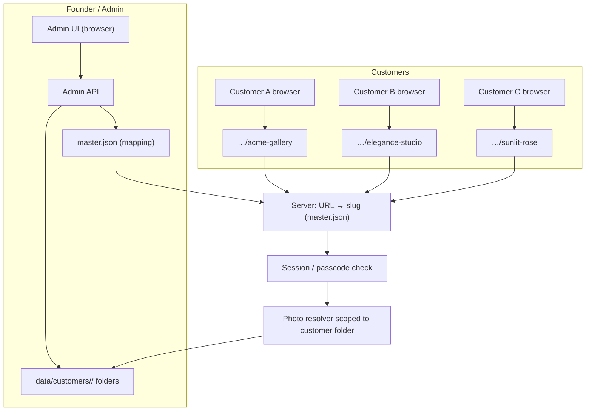
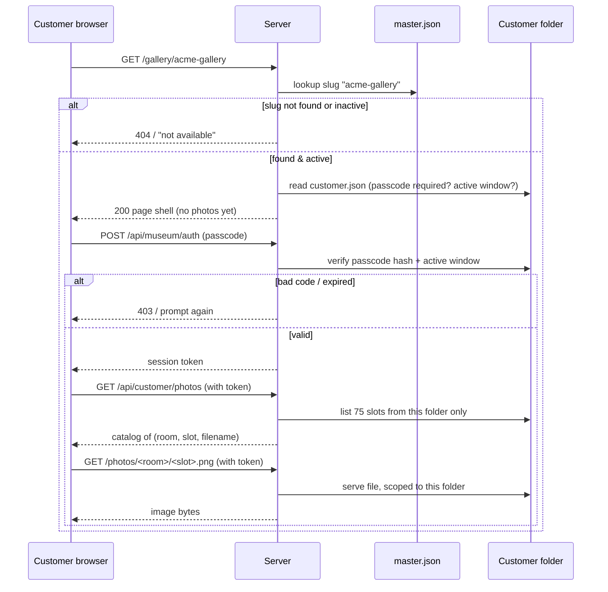
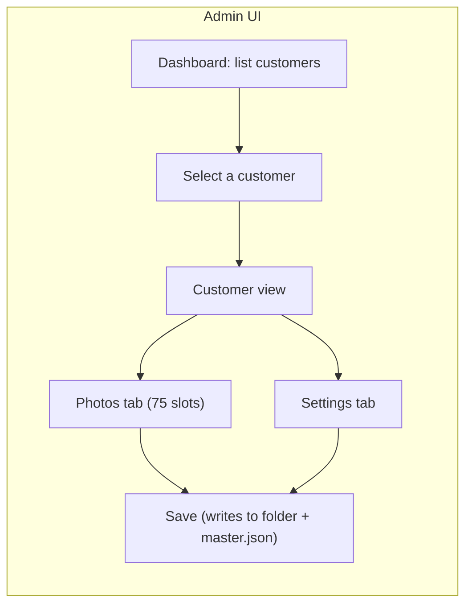
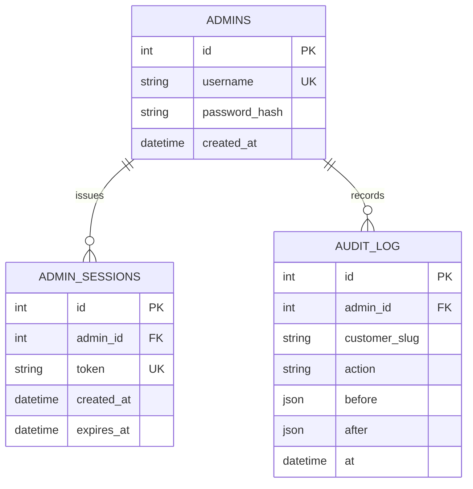
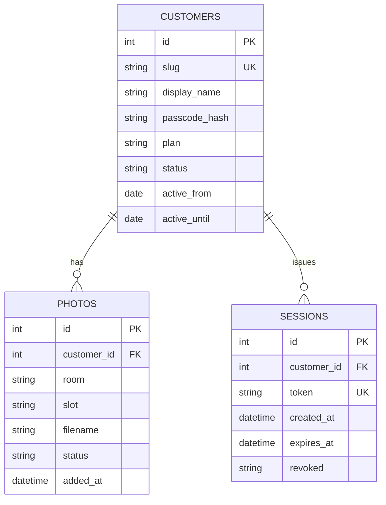

# Multi-Customer Photo Management — Architecture Plan

> Status: **Planning / Proposed** — no code changed yet.
> Owner: Engineering Lead (founder) · Location: `docs/planning/`

This document captures the **founder-proposed architecture** for serving many customers
from one museum app: one folder per customer, a master JSON mapping, a customer-scoped
URL, and an admin UI driven by the founder. It includes diagrams (Mermaid + ASCII),
the data model, an isolation/security design, and a phased rollout.

---

## 1. Core concept (one-line)

> **One customer = one folder. One URL = one folder (via a master JSON map).
> One admin UI edits any customer. The server is the only authority on "who sees what".**

Every customer gets a self-contained folder holding *all* of that customer's data:
their passcode / id, their photos (75-slot layout), quotes, dates, and any customization.
The customer's public page URL contains their folder name. A **master JSON file**
maps every incoming URL → the right folder, so deploying the app + the JSON + the
customer folders serves everyone.

---

## 2. High-level system diagram



- The **server** owns routing, auth, and scoping. The browser never guesses paths.
- **One deployed app** handles all customers; only data is per-customer.

---

## 3. Customer folder layout (data on disk)

```
data/customers/<slug>/
├── customer.json          ← id, slug, display name, passcode hash, plan, status
├── config.json            ← theme/UI overrides, quote dates, active window
├── quotes.json            ← customer-specific quote texts/dates
└── photos/
    ├── 00_grand_lobby/
    │   ├── 01_south_wall_masterpiece.png
    │   ├── 02_south_wall_companion_left.png
    │   └── 03_south_wall_companion_right.png
    ├── 01_fireside_winter_memories/   (12 slots)
    ├── 02_music_classical_melodies/   (12 slots)
    ├── 03_library_reading_nook/       (12 slots)
    ├── 04_masterpiece_paris_romance/  (12 slots)
    ├── 05_the_glass_orangery/         (12 slots)
    └── 06_secret_promise_alcove/      (12 slots)
```

- **75 slots** per customer (3 lobby + 6×12 salons), same layout for everyone.
- `customer.json` holds identity + credential material (hashed password).
- Everything about a customer lives under their folder → easy backup, copy, transfer.

---

## 4. Master JSON mapping (URL → folder)

The `master.json` file is the single routing table. It maps a customer slug (which
appears in the URL) to the actual data folder.

```json
{
  "customers": [
    {
      "slug": "acme-gallery",
      "folder": "acme-gallery",
      "displayName": "Acme Gallery",
      "plan": "standard",
      "status": "active",
      "activeFrom": "2026-01-01",
      "activeUntil": "2026-12-31"
    },
    {
      "slug": "elegance-studio",
      "folder": "elegance-studio",
      "displayName": "Elegance Studio",
      "plan": "premium",
      "status": "draft",
      "activeFrom": null,
      "activeUntil": null
    }
  ]
}
```

The server loads `master.json` at startup (and reloads on change). Incoming URL
`/gallery/<slug>` → look up slug → resolve photo/quote paths *only inside*
`data/customers/<slug>/`. If a slug is not in the master map, or its status is not
`active`, the server rejects it.

---

## 5. URL routing flow (sequence)



---

## 6. Admin page (founder-facing)

The admin UI is where the founder manages **all customers from one screen**.



What the founder can edit from the admin UI, **all persisted on Save**:

| Group | Editable items |
|---|---|
| **Identity** | display name, slug, plan, status (active/draft/paused) |
| **Access** | set/reset passcode (stored hashed), session duration, revoke current sessions |
| **Active window** | `activeFrom` / `activeUntil` dates, quote dates |
| **Photos** | upload/replace any of the 75 slots, preview per room/slot, delete |
| **Extras** | quotes, theme/UI overrides, notes |

Admin writes go through an **admin API** (separate, founder-only auth), never through
the public routes. On save, the server:
1. Writes the photo files into `data/customers/<slug>/photos/`.
2. Rewrites `customer.json` (passcode hash, name, window, plan).
3. Updates `master.json` (slug status/plan/display name).
4. Touches a version marker so browsers reload fresh data.

### 6.1 Admin UI screen layout (mockup)

```text
+--------------------------------------------------------------+
|  Admin Console                    [Founder]  [Log out]      |
+--------------------------------------------------------------+
|  P                          |  Customer: ACME Gallery       |
|  A   ▸ Dashboard            |  Slug: acme-gallery          |
|  N   ▸ All customers         |  Status: [Active v]          |
|  E   ▸ Add customer          |                               |
|  L   ▸ Settings             |  ┌─ Tabs ──────────────────┐ |
|      |  |  Identity | Access | Photos | Window | Quotes | |
|      |  |  └──────────────────────────────┘  | |
|      |  |  [content of the selected tab]      | |
|      |  |                                    | |
|      |  |  [ Cancel ]   [ Save changes ]      | |
|      |  |  └──────────────────────────────┘  | |
+--------------------------------------------------------------+
```

**Tab contents:**

| Tab | Contents |
|---|---|
| **Identity** | display name, slug (read-only once set), plan, status dropdown |
| **Access** | set/reset passcode, session duration, "revoke all sessions" button |
| **Photos** | 75-slot grid (room/slot thumbnail), upload/replace, delete, preview |
| **Window** | `activeFrom` / `activeUntil` date pickers |
| **Quotes** | list of quote texts + dates (from per-customer `quotes.json`) |

### 6.2 Admin API endpoints

All under `/api/admin/*`, founder-only auth, JSON bodies. Every write also bumps the
customer's version marker.

| Method | Path | Purpose |
|---|---|---|
| `GET` | `/api/admin/auth/session` | verify current admin session |
| `POST` | `/api/admin/auth/login` | founder login (rate-limited) |
| `POST` | `/api/admin/auth/logout` | end admin session |
| `GET` | `/api/admin/customers` | list all customers (from master.json) |
| `POST` | `/api/admin/customers` | create a new customer skeleton |
| `GET` | `/api/admin/customers/<slug>` | fetch one customer's full state |
| `PUT` | `/api/admin/customers/<slug>/identity` | update display name/plan/status |
| `PUT` | `/api/admin/customers/<slug>/access` | set/reset passcode, session duration |
| `DELETE` | `/api/admin/customers/<slug>/access/sessions` | revoke all sessions |
| `PUT` | `/api/admin/customers/<slug>/window` | update activeFrom/activeUntil |
| `PUT` | `/api/admin/customers/<slug>/quotes` | replace quote list |
| `GET` | `/api/admin/customers/<slug>/photos` | list the 75 slots with current files |
| `POST` | `/api/admin/customers/<slug>/photos/<room>/<slot>` | upload/replace a slot |
| `DELETE` | `/api/admin/customers/<slug>/photos/<room>/<slot>` | remove a slot's photo |

### 6.3 Admin authentication & data model

Founder login is **separate** from customer passcodes: it uses a distinct admin credential
(env-provided or an admin-only table), not a customer's passcode.



Every admin write is appended to **AUDIT_LOG** (`before`/`after` snapshots) so any
change can be traced — required for the compliance question below.

---

## 7. Isolation & security (must-haves)

1. **Passcode hashed** (e.g. scrypt/argon2) in `customer.json` — never plaintext, never logged.
2. **Server-authoritative scoping:** every photo/quote read resolves against the session's
   customer folder. A request for `…/photos/<room>/<slot>.png` is only served under
   the *session's* slug; cross-customer attempts → 403/404 with no info leak.
3. **URL ≠ trust:** a URL containing a slug does not grant access — the passcode/session
   check must still pass. The master map only decides *which folder*, not authorization.
4. **`master.json`+ customer folders are git-ignored** (photo contents, passcodes, slugs
   must never enter commits/reports).
5. **No secrets in logs/reports:** no passcode, no full folder paths, no private photos.
6. **Revocation:** revoking a session or setting status→draft immediately stops serving.
7. **Rate-limit** login attempts per customer (prevents brute force).
8. **Admin API is separate and founder-only**, with its own stronger auth.

---

## 8. Proposed data model (SQLite, initial)



> Files stay on disk in the customer folder; the DB records *which* photo occupies
> *which* slot per customer (source of truth for the catalog + admin grid).

---

## 9. What is reused vs. new

| Part | Today | Change |
|---|---|---|
| 75-slot layout | `tools/organize_photos.py` | add `--customer <slug>` target (write into folder) |
| Photo serving | `/photos/*` auth-gated | scope resolve to session's customer folder |
| Sessions/invites | `scripts/inviteStore.js` | scope to customer; add revoke/pause |
| Letters/quotes | `data/letters.json` | per-customer `quotes.json` |
| **Admin UI** | — | **new** founder API + UI |
| **master.json** | — | **new** routing table |

---

## 10. Phased rollout

1. **Phase 1 — scaffolding:** folder layout, `--customer` in organizer, `master.json`
   loader, `customer.json` schema. Validate 75-slot per customer.
2. **Phase 2 — isolation:** server scoping of `/photos/*` and a `/api/customer/photos`
   catalog endpoint; extend session/invite store per customer; unit + two-user sync +
   browser tests with two different customers on one server.
3. **Phase 3 — admin UI:** founder admin API + UI (photos grid, passcode, active window,
   quotes, save). Admin-only auth.
4. **Phase 4 — hardening:** rate limiting, revocation, backup/restore of customer
   folders, audit log of admin changes, performance re-check.

---

## 11. Open questions (answer before implementation)

1. Roughly how many customers, and how many photos each? (10 vs 1000 changes the DB call.)
2. Do customers **upload their own photos** (self-serve) or does the **founder import**
   them on their behalf? (Decides whether we build upload endpoints or only an admin importer.)
3. One shared museum engine (recommended) or a separate branded URL per customer?
4. Do you need per-photo replacement history / an approval workflow, or just "set a
   customer's 75 photos"?
5. Any compliance needs (right-to-delete, audit of who changed what)?

---

## 12. Status checklist

- [x] Research captured (this doc)
- [ ] Answer open questions (above)
- [ ] Phase 1: scaffolding + `--customer` in organizer
- [ ] Phase 2: server isolation + tests
- [ ] Phase 3: admin UI
- [ ] Phase 4: hardening + audit
