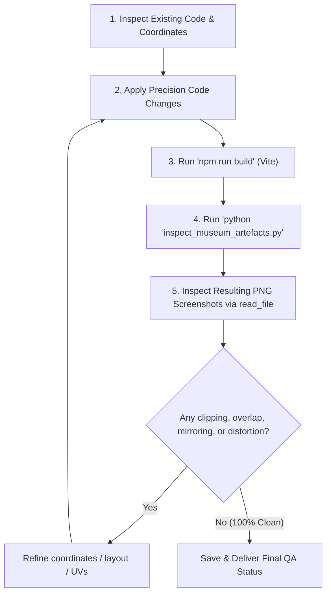

# Master Operating Contract & Universal Agent Guidelines

2026-11-05 active avatar directive supersedes older avatar-staging guidance:
Render the chosen local character, bind its position/facing/animations to movement
and mouse look, and use a third-person camera so the character remains visible.
Reuse the existing avatar loader for local and remote players with independent
skeletons. Keep the latest entrance behaviour: 0–100 progress, no retry buttons,
and show Enter only after the selected character is ready.

2026-11-04 entrance loader: Keep ENTER SANCTUARY disabled until the current
room's models (including plants), deferred artwork and texture loads finish,
and the room has been compiled/rendered. Show real loading activity and a retry
option for required-model failure. Optional missing photos keep their fallback
artwork. Preserve background salon prebuilding and the existing room-cache limit.

2026-11-04 collision update: Imported floor models use triangle-based walking
footprints, not one box around the entire model. Flat ground decoration is
excluded; separate parts retain walkable gaps even inside a single mesh.
Use the shared modelObstaclesFor path for both regular and LOD spawns.
This is static walking collision; future avatar seating requires its own action.

2026-11-04 sofa sizing update: The current 3d_pbr_curved_sofa.glb uses
targetHeight 1.1 m (about 29% larger than 0.85 m), centred and floor-aligned.

2026-11-04 subsequent user directive: Use the Monstera GLB for every gallery
plant, with its visible base flush to the local floor/platform. Place the Osgona
GLB chandelier at lobby centre with its top touching the 5.6 m ceiling, and the
white curved sofa set centred beneath it with its base on the floor. Use measured
model bounds, not export origins. Keep the two removed central downlights absent.

2026-11-04 user override: The lobby central chandelier and the two lower central
ceiling downlights marked blue in image/image.png are removed. Preserve the six
upper platform downlights. This supersedes older chandelier descriptions below.

> **PERMANENT DIRECTIVE FOR ALL AI AGENTS & DEVELOPERS:**
> This document is the **Single Source of Truth (SSOT)** and **Master Operating Contract** for this codebase. Any AI agent (Antigravity, Claude, Gemini, OpenAI, or human developer) operating on this project MUST read, adopt, and enforce every contract clause, behavioral rule, and architectural constraint written here **before** analyzing, creating, or editing code.
> 
> Whenever an architectural decision, layout change, user directive, bug fix, or performance optimization is made, the operating agent **MUST IMMEDIATELY UPDATE THIS DOCUMENT** so future sessions and different accounts preserve complete institutional memory and zero regressions.

---

## SECTION 1: UNIVERSAL AGENT BEHAVIORAL CONTRACT (APPLIES TO ALL TASKS & PROJECTS)

Regardless of the project type, technology stack, or specific user request, the following behavioral commandments are strictly enforced:

### Clause 1.1: Mandatory Pre-Execution Context Ingestion
- **Read First, Code Second**: Never write, edit, or refactor code without first inspecting the relevant files, existing architecture documents, session logs, transcripts, and decision files.
- **Understand Existing Scopes & Lifecycles**: Verify variable names, module imports, class hierarchies, coordinate systems, and parent/child lifecycles. Never guess variable or property names.
- **Preserve Documentation & Code Integrity**: Maintain comments, docstrings, type annotations, and structural patterns unrelated to your immediate task. Never blindly wipe out code blocks.

### Clause 1.2: Architecture & Session Documentation Maintenance
- **Continuous Documentation Updates**: Every time a structural decision, architectural pivot, performance rule, or visual constraint is established with the user, update:
  1. `PROJECT_INSTRUCTIONS.md` (this master contract).
  2. Any relevant architecture, audit, or decision logs (e.g., `DEAD_CODE_AUDIT.md`).
- **Context Portability**: This file must remain self-contained so that switching AI agents, models, or user accounts introduces zero degradation in understanding or execution quality.

### Clause 1.3: Zero-Assumption & Clarity Mandate
- When a user requirement involves ambiguous design choices, ask concise, targeted clarifying questions or present clean, viable options rather than making unverified guesses.
- When an explicit directive has been issued (e.g., "no text on enlarged image", "return to the exact door", "no floating rectangles"), that directive is an **absolute constraint** with zero exceptions.

### Clause 1.4: Strict Zero-Regression & Mandatory Visual/Functional Verification
- **Never Rely Solely on Syntax Checks**: Passing build/compile steps (`npm run build`) is necessary but **never sufficient**.
- **Automated Verification Loop**: Before declaring any visual, spatial, or architectural task complete, execute the automated Playwright/inspection script, capture full-resolution screenshots, and **inspect the resulting images directly using image viewing tools** (`read_file`) to verify that layouts, lighting, textures, and clearances are physically and visually flawless.
- If any visual defect, clipping, text mirroring, or distortion is detected, fix it and re-verify until 100% clean.

### Clause 1.5: File Hygiene & Dead Code Prohibition
- Never leave temporary test files, throwaway debug scripts, or scratch captures in production directories.
- Eliminate dead, orphaned, or deprecated code immediately. Never leave commented-out legacy modules or unused libraries cluttering the repository.

---

## SECTION 2: SYSTEM ARCHITECTURE & MASTER PROJECT CONTRACT (OUR MUSEUM 3D)

**Our Museum 3D** is an ultra-luxury, photorealistic 3D virtual art museum and memorial sanctuary built with **Three.js** and **Vite**. The museum is divided into:
- **Grand Lobby (Central Rotunda)**: Features a high central atrium, Grand Double-Ring Crystal Chandelier, Grand Exhibition Directory Monument, symmetrical grand staircases, elevated promenade platforms (East & West Wings), South Grand Sanctuary Masterpiece, flush architectural ceiling downlights, and fluted wall sconces.
- **6 Themed Memory Salons**:
  1. *Fireside Winter Memories* (Marble hearth, flickering fire, mantel clock, candles, Persian rug, curved French club armchairs).
  2. *Music & Classical Melodies* (Grand piano, cello, violin, music stands, open acoustic space).
  3. *The Library & Reading Nook* (Emerald velvet curved French armchair, brass pharmacy reading lamp, quiet corners).
  4. *Masterpiece Paris Romance* (Classical fluted Roman urn pedestals, crystal chandelier, romance narrative).
  5. *The Glass Orangery* (Lush botanical pedestals, conservatory ambiance, soft skylights).
  6. *The Secret Promise Alcove* (Burgundy leather curved armchair, dedication memories).

---

## SECTION 3: SPECIFIC ARCHITECTURAL & INTERACTION CONSTRAINTS

### Constraint 3.1: Strict Zero-Obstruction of Artworks & Doors
- **Zero Artwork Overlap**: Under **NO CIRCUMSTANCES** may any furniture piece (armchair, table, bench), lamp, pedestal, urn, or wall sconce clip into, overlap, or block any part of an artwork frame, canvas, or title plaque.
  - Wall sconces must maintain at least **$1.5\text{m}$ horizontal clearance** from any painting frame.
  - Floor furniture must sit in open floor zones or along walls where zero artworks are hung.
  - Fireplace mantels, clocks, and candles must have at least **$15\text{cm} - 20\text{cm}$ vertical clearance** below the bottom of the wall masterpiece above them.
- **Zero Door Blocking**: All door openings and walkways must remain **$100\%$ accessible and clear**. Never place armchairs, lamps, plants, or pedestals in front of or within $2.0\text{m}$ of any door entrance.

### Constraint 3.2: 100% Realistic, Curved & Organic Furniture (No Blocky Cuboids)
- **Never create blocky cuboid furniture**: The user explicitly rejected furniture made of 3 simple boxes or cuboids.
- All armchairs and sofas must use **organic, curved geometry**:
  - French barrel tub armchairs (`createLuxuryArmchair`) with curved cylindrical/toroidal backs (`CylinderGeometry`, `TorusGeometry`).
  - Chamfered seats with welt cord piping (`TorusGeometry`).
  - Splayed, turned tapered legs with polished brass sabot ferrules (`CylinderGeometry`).
  - Tufted backrest buttons and sculpted down cushions.
  - Zero floating gaps between cushions and plinths.

### Constraint 3.3: Photo Lightbox Modal — Pure Artwork View Only (Zero Text)
- When a user clicks an artwork in 3D to enlarge it (via `openPhotoLightbox` in `src/main.js`):
  - **DO NOT DISPLAY OR PRINT ANY TEXT**: Do not show "SANCTUARY EXHIBITION", do not show artwork titles, subtitles, or "Click outside or press [ESC] to return to gallery".
  - The enlarged modal must present **purely the image** in a clean, elegant border with a close button and backdrop click dismissal.

### Constraint 3.4: Photo Frame Auto-Fit (No Distortion or Letterboxing Gaps)
- Uploaded and rendered photos must **automatically fit the frame**:
  - Never allow an image to look squished, stretched, or letterboxed with blank gaps inside the frame.
  - Use `autoFitTextureCover(tex, baseW, baseH)` to calculate the aspect ratio and automatically center-crop textures using texture repeat and offset.

### Constraint 3.5: Door Locomotion & Return-to-Door Navigation Continuity
- **Do not reset to lobby center on room exit**: When a user enters a salon from a specific lobby door and later clicks "Return to Grand Lobby", they must return to **the exact door on the platform from which they entered**, facing outward into the lobby.
- Never spawn the user at the default lobby center $(0, 1.7, 4.0)$ when returning from a salon, because that forces them to walk up the stairs again.
- **Comprehensive Door Continuity**: All doors across the museum must remain fully functional:
  - Lobby $\to$ Salons (East & West wings).
  - Salon Exit Door $\to$ Exact lobby door on platform.
  - Re-entering the same or any other salon $\to$ Immediate, seamless entry.
  - Inter-salon corner doors (`seealso` 0–5) $\to$ Direct, smooth room-to-room transitions.

### Constraint 3.6: Fast Zero-Lag Transitions & Multi-Tier Asset Caching
- **Door Plaque Canvas Texture Caching**: In `doors.js`, all door destination plaques are cached in `doorPlaqueTextureCache` by title. Canvases are rendered **once** on demand and reused indefinitely with **zero canvas allocation** on room shifts.
- **Photo Texture Caching**: Decoded artwork textures are cached in `loadedPhotoTextureCache` in `engine.js` so re-entering previously visited rooms loads textures **synchronously and instantaneously**.
- **GPU Pipeline Warming**: Always execute `renderer.compile(currentRoom.group, camera)` inside `setRoom` so WebGL shaders compile ahead of the frame cycle, eliminating the 300ms–800ms shader stall.
- **Direct Door Metadata Assignment**: In `room.js`, pass `category`, `articleTitle`, and `label` directly into `addDoor` at construction time. Never rely on post-load `setTimeout` routines.
- **Harmonized Interaction Range & Proximity Transitions**:
  - Door click reach and hand-cursor detection are harmonized to exactly **6.0 meters** with first-priority raycast testing.
  - Door clicks trigger immediately on the very **first click** even when the pointer is not locked yet (while simultaneously requesting pointer lock).
  - Walking within **0.50 meters** of an active doorway smoothly triggers the transition, tight enough to prevent accidental triggers when standing nearby.
- **Instant Offline Navigation**: `requestRandomExhibit` picks directly from `coupleCategories` with zero network latency.

### Constraint 3.7: Pristine Airspace (Zero Floating Particles or Rectangles)
- **Zero WebGL Points or Dust Motes**: Never add `THREE.Points` or ambient dust/ember particle systems to the scene. In WebGL, points without circular alpha sprites render as pixelated square/rectangular white boxes hovering in 3D space, which clutters the room and distracts from the art.
- **Pristine Air**: All rooms and the lobby must maintain 100% clean, clear airspace with zero hovering white artifacts, petals, or rectangles.

### Constraint 3.8: Plane Geometry Texture Orientation (No Mirrored Text/Art)
- When placing artwork or text meshes on back walls or rotated partition faces (e.g. facing North or rotated by $\pi$):
  - In Three.js, rotating a `PlaneGeometry` by $\pi$ around $Y$ inverts the horizontal UV layout from the viewer's perspective ($U=1$ on left, $U=0$ on right).
  - Always verify that the texture and text read correctly **left-to-right**. If rotating by $\pi$, invert the geometry UVs (`uv.setX(i, 1 - uv.getX(i))`) or adjust orientation so text is never mirrored backwards.

### Constraint 3.9: Architectural Lighting Bezels (No Bulky Black Cans)
- Ceiling downlights in the Grand Lobby and Salons must use **flush, slim architectural ring bezels** (`RingGeometry(0.18, 0.23, 32)`), not bulky black cylindrical cans protruding down from the ceiling.

### Constraint 3.10: Strict Dead Code Elimination & Avatar Staging Policy
- **Zero Inactive Code in Active `src/`**: Never leave dead modules or unused functions in the runtime source tree.
- **Avatar Staging**: The avatar system (Maya & Jack GLTF bone animation mixers, sit poses, dance routines, and couple controllers) is safely preserved and staged in `archive/avatars/characters.js` ready for Phase 2 integration *after* the complete 3D UI, museum galleries, and spatial architecture are 100% finished.
- **Permanent Purges**: Non-avatar dead code (e.g. `src/wiki/wiki.js`, `makeMarbleTexture`, `hashStringToSeed`, `seededRand`, `placeCaptionUnderSlot`, `placePhotoWithCaption`, `labelFromImageUrl`, `makePlaqueTexture`, and `dustParticles`) is permanently purged from the repository.

---

## SECTION 4: PRE-CODING CHECKLIST (WHAT TO DO BEFORE WRITING CODE)

Before writing or editing code in this repository:
1. **Read Existing Code First**: Inspect target files using `read_file` around the exact lines of interest to verify variable names, coordinate systems, and scope.
2. **Understand the Room Coordinate System**:
   - Grand Lobby: Width $X \in [-10.5, +10.5]$, Length $Z \in [-6.0, +6.0]$, Height $4.0\text{m}$.
   - Elevated Platforms: $X \le -2.5$ (West) and $X \ge 2.5$ (East), Floor Height $Y = 1.4\text{m}$, Upper Ceiling $Y = 5.6\text{m}$.
   - Salons: Width $X \in [-5.0, +5.0]$, Length $Z \in [-6.0, +6.0]$, Height $4.0\text{m}$.
   - Divider Partition: Located at $Z = 0$, width $5.0\text{m}$, thickness $0.3\text{m}$.
   - Salon South Door (Entrance): $Z = +6.0\text{m}$.
   - Salon North Wall: $Z = -6.0\text{m}$.
   - Salon Corner Doors (`seealso` 0, 1, 2, 3): $Z = \pm 4.40\text{m}$ along East and West walls.
3. **Calculate Visual & Collision Clearances**:
   - Verify that any newly placed object has at least $1.5\text{m}$ clearance from artwork frames and $2.0\text{m}$ clearance from door jambs.
4. **Check Scope & Imports**: Ensure any Three.js classes, materials, or helper functions are properly imported and scoped before referencing them (avoids runtime crashes like `reference errors`).

---

## SECTION 5: DEVELOPER & AGENT WORKFLOW (AUTOMATED SCREENSHOT QA LOOP)

Whenever modifying rooms, artefacts, furniture, lighting, or layouts:



### Running the Inspection Script
The project includes a Playwright screenshot automation script: `inspect_museum_artefacts.py`.
- To execute:
  ```powershell
  python inspect_museum_artefacts.py
  ```
- Requires WebGL-enabled Chromium flags:
  `['--use-gl=angle', '--use-angle=d3d11', '--enable-webgl', '--ignore-gpu-blocklist']`
- Automatically captures 17 key perspectives into `screenshots/artefact_inspection/`.
- **Always visually inspect the output images** using `read_file` to confirm visual quality with your own eyes before concluding your turn.

---

## SECTION 6: REPOSITORY FILE MAP & RESPONSIBILITIES

| File Path | Core Responsibility |
| :--- | :--- |
| `src/main.js` | App bootstrap, UI overlay, ticket pass modal, photo lightbox modal, pointer lock, room transition listeners, and global APIs. |
| `src/engine/engine.js` | Three.js engine core: rendering loop, camera locomotion (WASD + mouse look), collision resolution, door triggers, and camera debug API (`setCameraPosition`). |
| `src/game/room.js` | Salon generator: builds walls, floors, ceilings, center partition wall, artwork slots, text narrative panels, and calls room decorators. |
| `src/game/room/lobby.js` | Grand Lobby generator: high atrium, central chandelier, directory monument, grand staircases, elevated promenade platforms, and architectural wall sconces. |
| `src/game/room/decorations.js` | Luxury furniture and artefact definitions: French curved armchairs, marble fireplace, mantle clock, candles, Persian rugs, pedestals, Roman urns, reading lamps, and chandeliers. |
| `src/game/room/doors.js` | Door jambs, headers, door plates, interactive door triggers, spotlight fixtures, and salon destination plaques with memory caching. |
| `src/config/artworkSizes.js` | Dimensions, heights, and vertical centers for all artwork categories (masterpiece, gate art, partition highlights, narrative boards). |
| `src/data/coupleMuseum.js` | Curated salon metadata, love letters, dedication quotes, memories, and canvas artwork generators. |
| `src/admin/placementStudio.js` | Admin-only Placement Studio v1: UI catalog, inspector, ghost placement, transform validator, undo/redo stack, and draft autosave. |
| `src/admin/placementTopView.js` | Admin-only Top-Down Orthographic Map View (`T` key): 2D/3D architectural floor plan, 2.0m door keep-out circles, artwork slots, drag move & rotate handle. |
| `src/admin/layoutIO.js` | Admin-only layout JSON export/import and schema validation against `museumLayout.json`. |
| `src/game/room/artifactRegistry.js` | Central catalog registry of all museum decor artifacts, metadata, footprints, variants, and builder functions. |
| `src/game/room/placedItems.js` | Placed items manager: scene spawning, lifecycle, transform updates, disposal, and default layout loading. |
| `src/game/room/artifacts/` | (removed) Procedural artifact builders were deleted in favour of the GLB 3D model registry. |
| `inspect_museum_artefacts.py` | Automated visual inspection script using Playwright to capture 17 viewpoints across the Grand Lobby and Salons 1–6. |
| `server.js` | Production Node.js HTTP & WebSocket server running on port `8080`. |
| `DEAD_CODE_AUDIT.md` | Comprehensive dead code audit and transition lag analysis. |
| `PROJECT_INSTRUCTIONS.md` | This Master Operating Contract and Single Source of Truth. |
| `screenshots/artefact_inspection/` | Directory holding the latest high-resolution inspection screenshots. |

---

## SECTION 7: WHAT NEVER TO DO (COMMON PITFALLS & ANTI-PATTERNS)

1. **NEVER use blocky cuboids for seating or decor** — always use organic curved geometry with turned legs and welt piping.
2. **NEVER place picture lamps crossing into artwork borders** — let ceiling downlights and wall sconces illuminate artworks naturally.
3. **NEVER show titles or instructions in the enlarged artwork modal** — keep it a pure, distraction-free view.
4. **NEVER spawn the user in the lobby center after exiting a room** — always preserve the entry door position.
5. **NEVER leave text unpadded against footers on narrative boards** — render at $2048\text{px}$ with dynamic line-height calculation.
6. **NEVER place furniture in front of door jambs** — maintain at least $2.0\text{m}$ open clearance around all doors.
7. **NEVER mirror text or artwork on back faces of partition walls** — verify UV coordinate orientation.
8. **NEVER add floating dust particles, embers, points, or plane petals** — airspace must be crystal clear.
9. **NEVER recreate 2D canvases per door on every transition** — always use `doorPlaqueTextureCache`.
10. **NEVER rely solely on unit tests or compile steps** — **always inspect the visual screenshots** in `screenshots/artefact_inspection/`.

---

## SECTION 8: PLACEMENT STUDIO, ARTIFACT REGISTRY & ROOMKEY SPECIFICATION

### 8.1 Stable RoomKey Scheme
All museum rooms have a fixed, canonical `roomKey` passed into `buildRoom` and the engine:
- `'lobby'` — Grand Central Rotunda / Atrium
- `'fireside'` — Salon 1: Fireside Winter Memories
- `'music'` — Salon 2: Music & Classical Melodies
- `'library'` — Salon 3: The Library & Reading Nook
- `'paris'` — Salon 4: Masterpiece Paris Romance
- `'orangery'` — Salon 5: The Glass Orangery
- `'alcove'` — Salon 6: The Secret Promise Alcove

### 8.2 Museum Layout JSON Schema (v1)
Layouts are exported and committed to `src/data/museumLayout.json`:
```json
{
  "version": 1,
  "exportedAt": "ISO-8601 string",
  "rooms": {
    "fireside": [
      {
        "id": "itm_...",
        "type": "torchere_artdeco",
        "x": 3.9, "y": 0, "z": 4.6,
        "rotY": 3.927,
        "scale": 1.0,
        "variant": "brass-frosted",
        "contact": "floor",
        "parent": null,
        "locked": false
      }
    ],
    "lobby": [],
    "music": [],
    "library": [],
    "paris": [],
    "orangery": [],
    "alcove": []
  }
}
```

### 8.2.1 GLB Model Items (Step 2/3 pipeline)
Items with `"type": "glb"` load a normalized model from the manifest folder:
```json
{
  "id": "itm_glb_bookcase",
  "type": "glb",
  "path": "models/ready/furniture/furniture_bookcase.glb",
  "position": { "x": 4.6, "y": 0.016, "z": -4.2 },
  "rotationY": 1.5708,
  "scale": 0.01254,
  "contact": "floor"
}
```
- `scale` is the **real-world scale factor** applied to the model (source
  Sketchfab units vary wildly — bookcase ≈160 units, osgona chandelier ≈1767
  units — so scale is computed per model so world height equals the manifest's
  `realHeightMetres`).
- `position.y` compensates for the model's native min-Y so floor items sit flush
  on y=0 (≤1 cm gap).
- `contact` is `floor` | `ceiling` | `wall`. Only `floor` items register a
  collision obstacle (world bounding box) so the player cannot walk through them.
- Loading uses a **shared GLTFLoader cache** (load once per path) and each spawn
  deep-clones geometry/materials/textures into per-room `disposables` so room
  changes dispose them safely. Ceiling/wall items do not block movement.
- Source models live in `public/models/ready/{furniture,lighting,plants}/`;
  metadata is in `public/models/ready/models.manifest.json`; credits in
  `public/models/ready/ATTRIBUTIONS.md`. Draco decoder files are bundled locally
  under `public/models/ready/draco/` (no CDN).
- See `ALIGNMENT_REPORT.md` for the placement/verification record.

### 8.3 Key Bindings in Admin Studio Mode
- `B` — Toggle Placement Studio Build Mode (closes Resizer drawer; available in `admin.html` only).
- `Tab` — Toggle Walk (pointer-lock WASD) vs Cursor mode (UI panel interaction & free mouse).
- `T` — Toggle Top-Down Orthographic Map View.
- `M` — **Preserved for Ambient Audio** toggle (do not overwrite).
- `R` — Toggle Live Artwork Resizer drawer (suspends Build mode).
- `F` — In Build Mode: Drop active object / ghost to floor ($Y = 0$). Outside Build Mode: Fullscreen toggle.
- `Space` — In Build Mode: Place and retain artifact selected for repeat placement. Outside Build Mode: Player Jump.
- `Q` / `E` — Rotate ghost or selected item by $\pm 15^\circ$.
- `Mouse Wheel` — Rotate ghost by $\pm 15^\circ$ (`Shift` for $\pm 1^\circ$).
- `Arrow Keys` — Nudge ghost / selected item $5\text{ cm}$ along $X/Z$ plane (`Shift` for $1\text{ cm}$).
- `G` — Grab selected placed item back into cursor placement mode.
- `Delete` — Remove selected placed item (with undo support).
- `Ctrl+D` — Duplicate selected placed item with $0.5\text{m}$ offset.
- `Ctrl+Z` / `Ctrl+Y` — 50-step Undo / Redo placement stack.
- `Esc` — Deselect item or exit Build Mode.

### 8.4 Validator & Clearance Rules (Live Spatial Checking)
- **Live Spatial Checking**: Free zones and clearances are dynamically computed against live `room.bounds`, `room.doors`, `room.slots`, and existing placed items—never hard-coded coordinates.
- **Door Keep-Out**: Minimum $2.0\text{m} + r_\text{footprint}$ radius around every door position (`room.doors`).
- **Artwork Slot Clearance**: Wall items must maintain $\ge 1.5\text{m}$ horizontal clearance from slot edges (`room.slots`).
- **Footprint-vs-Footprint**: Strict collision check prevents overlapping bounding circles/boxes of adjacent items.
- **Walkable Gap**: Minimum $0.8\text{m}$ navigable clearance between floor items to maintain open visitor flow.
- **Light Budget**: Strict cap of $\le 8$ dynamic point/spot lights per room; additional glow handled via emissive materials.
- **Strict / Relaxed Toggle**:
  - *Strict*: Enforces full $1.5\text{m}$ lateral artwork slot clearance for all items.
  - *Relaxed*: Permits low furniture ($\le 0.9\text{m}$ tall) underneath wall art if $\ge 0.35\text{m}$ vertical clearance below the bottom frame edge is maintained.

### 8.5 Draft Autosave & Bundle Isolation
- **Draft Autosave**: Layout changes automatically debounce-save to `localStorage['ourmuseum:layoutDraft:v1']`. On Studio boot, an alert banner offers instant one-click draft restore.
- **Zero Public Overhead**: Studio code (`placementStudio.js` and `layoutIO.js`) is dynamically imported only when `isAdmin` is detected. Public visitors (`index.html`) receive 0 kB of Studio logic.

### 8.6 Multiplayer Network Rules (live 3D avatars)
- **Verification**: live results and PASS/FAIL checks are recorded in `MULTIPLAYER_REPORT.md`.
- **Server**: `server.js` runs the WebSocket relay on the same HTTP port (`/ws` upgrade). A shared session room is `our-home`; at most **2** clients (`MAX_PLAYERS_PER_ROOM`).
- **One avatar per connection**: the server *assigns* each connection a `peerId` — it never trusts a client-supplied id. Every `state` message is rebroadcast under the connection's own id.
- **Validation/clamping**: `state.p` clamped to ±100; `chat.m` capped at 120 chars; per-type rate limit 30 msg/s; unknown types and bad JSON are rejected with an `{t:'error'}` reply.
- **No stored data**: the server holds only the live in-memory session; nothing is persisted.

### 8.7 Message Format (compact JSON relay)
- `join` → `{t:'join', name, color, model, room}`; server replies `{t:'room_state', room, peerCount, peers[], yourId}` and broadcasts `peer_joined`.
- `state` → `{t:'state', p:[x,y,z], ry, room, anim, moving, mode, seat}` (sent ~20 Hz, only while changed).
- `emote` → `{t:'emote', e:1-6, start}` · `sit` → `{t:'sit', seat}` · `stand` → `{t:'stand'}`.
- `chat` → `{t:'chat', m}` (≤120 chars, plain text) · `ping`/`pong` → latency.
- `leave` → `{t:'leave'}`; server broadcasts `peer_left`.

### 8.8 Multiplayer Keys (kept distinct from existing bindings)
- `W A S D / arrows` move · `Space` jump · `M` audio · `F` fullscreen · `ESC` unlock cursor (all unchanged).
- `1` Wave · `2` Dance · `3` Clap · `4` Point (emote menu).
- `E` Interact: sit on nearest seat (or stand).
- `Enter` open chat; type; `Enter` send / `ESC` cancel.
- Emotes cancel on movement; while the chat box is focused no movement/emote/audio/fullscreen keys act.

### 8.9 Seat Anchor Convention
- Any GLB item may define `seats: [{ id, x, z, yaw, height }]` on its artifact in `artifactRegistry.js`.
- `x/z` are local offsets in metres from the item centre; `height` is the cushion height above the floor; `yaw` is the facing direction.
- `seatRegistry.js` converts these to world-space anchors (applying item `x/y/z`, `rotationY`, `scale`) for every `museumLayout.json` GLB item. Seats are occupancy-locked (two avatars cannot share one).
